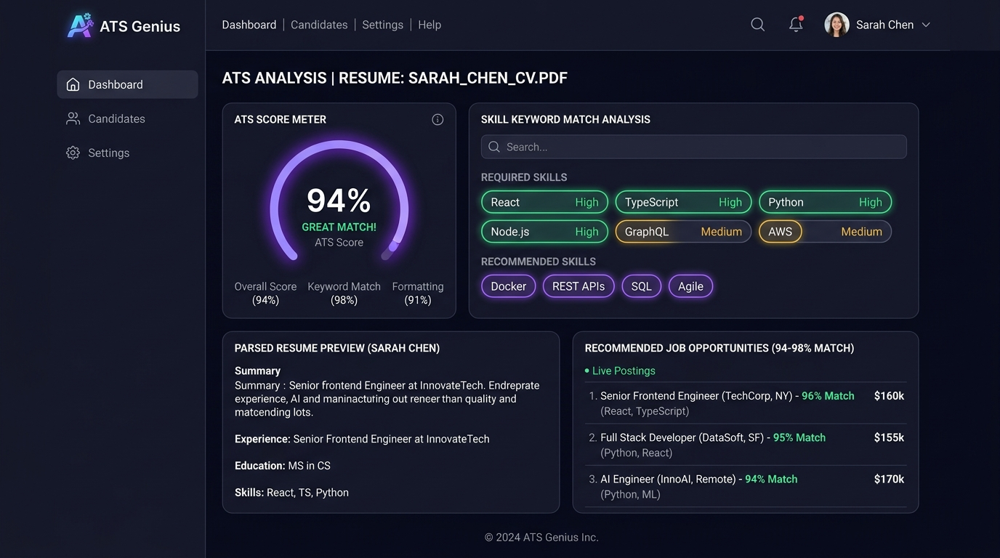
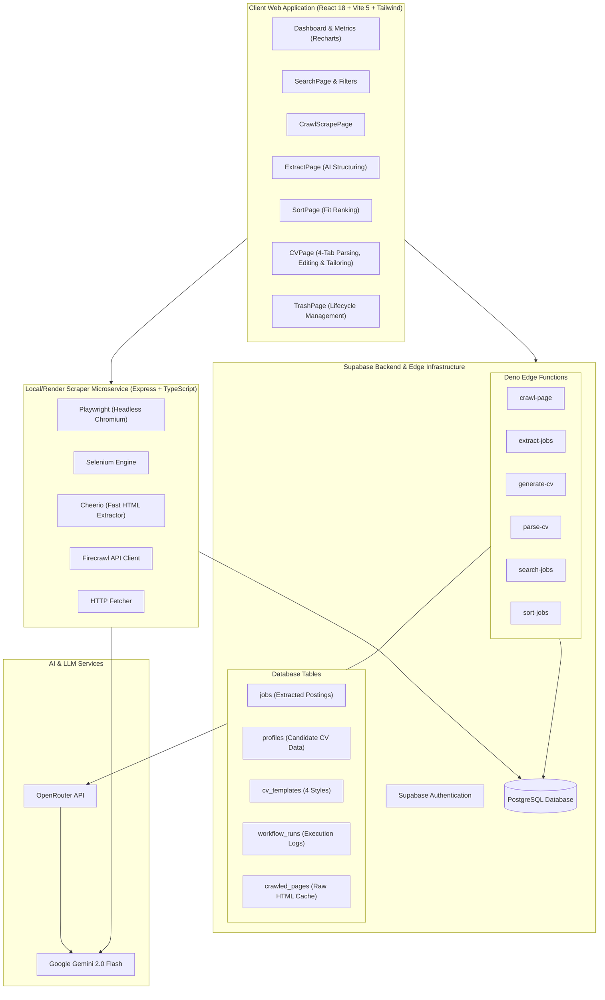
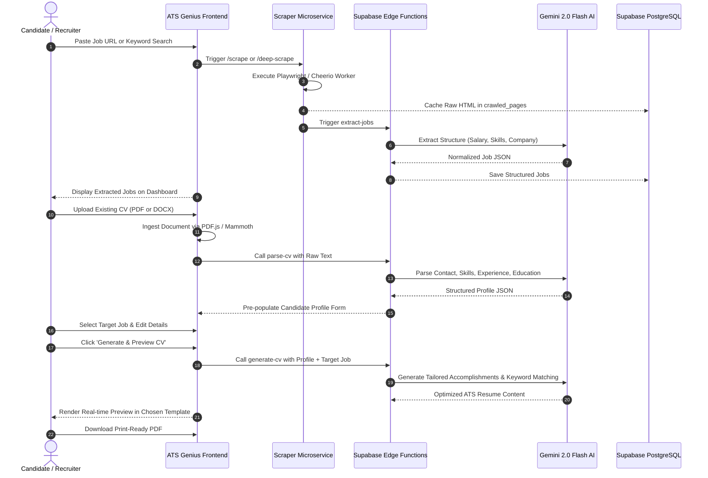

<div align="center">

# 🎯 ATS Genius

**Enterprise AI Applicant Tracking System, Multi-Engine Job Scraper & Intelligent Resume Tailoring Suite**

[](https://www.typescriptlang.org/)
[](https://react.dev/)
[](https://vitejs.dev/)
[](https://supabase.com/)
[](https://playwright.dev/)
[](https://www.docker.com/)
[](https://deepmind.google/technologies/gemini/)

<br />



<br />

[Features](#-core-capabilities) • [System Architecture](#-system-architecture) • [End-to-End Workflow](#-end-to-end-recruitment-workflow) • [Scraper Microservice](#-multi-engine-scraper-microservice) • [Edge Functions](#-supabase-edge-functions) • [Quickstart](#-quickstart--installation) • [Deployment](#-deployment-guide)

</div>

---

## 🌟 Executive Overview

**ATS Genius** is an end-to-end recruitment intelligence platform designed to automate every phase of the job acquisition lifecycle: from discovering hidden opportunities across top hiring platforms, to parsing and analyzing applicant CVs against Applicant Tracking System (ATS) algorithms, to generating tailored, interview-ready resumes with high ATS scores.

Equipped with a distributed **multi-engine web crawler** (Playwright, Selenium, Cheerio, Firecrawl), cloud-native **Supabase Edge Functions**, and **Google Gemini 2.0 Flash AI**, ATS Genius empowers job seekers and recruiters to bridge the gap between job requirements and candidate profiles with surgical precision.

---

## ⚡ Core Capabilities

### 1. 🔍 Multi-Source Intelligent Job Discovery & Crawling
- **Automated Web Crawling**: Crawls job boards, remote aggregators, and corporate career portals.
- **JavaScript Rendering Engine**: Seamlessly bypasses client-rendered Single Page Applications (SPAs) on platforms like LinkedIn, Indeed, Glassdoor, Himalayas, RemoteOK, and WeWorkRemotely.
- **Deep Scraping & Link Discovery**: Automatically identifies pagination and extracts nested job description links.

### 2. 🧠 AI Job Extraction & Semantic Sorting
- **Structured Data Parsing**: Uses Gemini 2.0 Flash to convert raw, unstructured HTML into normalized JSON schemas (Job Title, Company, Compensation, Employment Type, Required Skills, Remote Status).
- **Match Scoring & Ranking**: Evaluates applicant qualifications against extracted criteria to sort opportunities by alignment.
- **Trash & Archive Management**: Complete soft-delete and restoration lifecycle for managing active applications.

### 3. 📄 Multi-Format Resume Parsing Engine
- **Universal File Ingestion**: Ingests both **PDF** (via `pdfjs-dist`) and **DOCX** (via `mammoth`) documents entirely client-side.
- **Profile Entity Extraction**: Segregates raw document text into Contact Information, Executive Summary, Technical Skills arrays, Work History, and Academic Credentials.
- **Dynamic Profile Editor**: Allows users to interactively add, edit, or remove multiple employment entries and degree certificates before generation.

### 4. 🎨 AI Resume Tailoring & ATS Optimization
- **Target Job Skill Alignment**: Cross-references candidate accomplishments against the target role's keyword taxonomy.
- **4 Professional CV Layout Templates**:
  - `Professional`: Clean corporate styling optimized for enterprise ATS parsers.
  - `Modern`: Contemporary bold typography with high visual impact.
  - `Minimal`: Content-focused layout emphasizing technical depth.
  - `Creative`: Dynamic layout for design, product, and growth roles.
- **Vector PDF & Image Export**: Generates pixel-perfect, print-ready PDF resumes using `jspdf` and `html2canvas`.

---

## 🏗️ System Architecture



---

## 🔄 End-to-End Recruitment Workflow



---

## 🕷️ Multi-Engine Scraper Microservice

Located in the `scraper/` directory, the microservice is built with Express and TypeScript and deployed via Docker or Render (`render.yaml`).

### Supported Scraping Engines
| Engine | Best For | When Used |
| :--- | :--- | :--- |
| **Playwright** | JavaScript-heavy portals (LinkedIn, Indeed, Himalayas) | URLs in `JS_REQUIRED_SITES` |
| **Cheerio** | Static job boards, standard HTML pages | High-speed lightweight HTML parsing |
| **Selenium** | Fallback for complex automated browser sessions | Complex form and session handling |
| **Firecrawl** | Clean markdown and structured web extraction | When Firecrawl API key is present |
| **HTTP Fetch** | Direct REST endpoints and basic static websites | Fast initial connectivity check |

### Microservice Endpoints
- `GET /health`: Health check and status of available scraping engines.
- `POST /scrape`: Ingests single target URL, executes browser engine, returns HTML/text.
- `POST /deep-scrape`: Recursive crawler finding nested job detail links.
- `POST /extract`: Extracts normalized job records directly via Gemini AI.

---

## ⚡ Supabase Edge Functions

All edge functions reside in `supabase/functions/` and are built on Deno with CORS support:

1. **`parse-cv`**: Accepts raw resume text, prompts Gemini 2.0 Flash to extract structured schema (contact, summary, skills, experience, education).
2. **`generate-cv`**: Synthesizes candidate history with target job description to produce tailored, high-scoring ATS bullet points.
3. **`extract-jobs`**: Converts raw webpage text into structured job listing rows.
4. **`search-jobs`**: Queries and aggregates external job search APIs.
5. **`sort-jobs`**: Semantic ranking comparing candidate profiles with open postings.
6. **`crawl-page`**: Edge-level HTTP crawler for fast metadata fetching.

---

## 📁 Repository Structure

```
ats-genius/
├── docs/
│   └── assets/
│       └── banner.jpg        # Product interface preview banner
├── scraper/                  # Multi-Engine Scraper Microservice
│   ├── services/
│   │   ├── cheerio.ts        # Fast HTML & link parsing
│   │   ├── firecrawl.ts      # Firecrawl API integration
│   │   ├── gemini.ts         # Gemini AI schema extraction
│   │   ├── httpFetch.ts      # Lightweight HTTP fetcher
│   │   ├── playwright.ts     # Headless Chromium automation
│   │   ├── selenium.ts       # Selenium WebDriver service
│   │   └── supabase.ts       # Direct PostgreSQL persistence
│   ├── Dockerfile            # Container build specification
│   ├── package.json          # Scraper microservice dependencies
│   ├── render.yaml           # One-click Render deployment configuration
│   ├── server.ts             # Express REST API server
│   └── tsconfig.json         # TypeScript configuration
├── src/
│   ├── components/           # Reusable UI widgets & Shadcn primitives
│   ├── contexts/
│   │   ├── SidebarContext.tsx# Navigation sidebar layout state
│   │   └── ThemeContext.tsx  # Dark/Light mode theme state
│   ├── pages/
│   │   ├── Auth.tsx          # User login & authentication
│   │   ├── CrawlScrapePage.tsx# Job board web crawler dashboard
│   │   ├── CVPage.tsx        # 4-Stage CV Parser, Editor & Generator
│   │   ├── Dashboard.tsx     # Application overview & analytics
│   │   ├── ExtractPage.tsx   # AI job attribute extraction
│   │   ├── SearchPage.tsx    # Multi-engine job search & filters
│   │   ├── SortPage.tsx      # Semantic candidate fit ranking
│   │   └── TrashPage.tsx     # Soft-deleted application recovery
│   ├── App.tsx               # Primary router & providers
│   └── main.tsx              # Application entry point
├── supabase/
│   ├── functions/            # 6 Deno Edge Functions
│   └── migrations/           # Database schemas, templates & RLS policies
├── package.json              # Frontend dependencies and scripts
├── tailwind.config.ts        # Tailwind styling & animations
└── vite.config.ts            # Vite 5 bundle configuration
```

---

## 🛠️ Quickstart & Installation

### 1. Frontend Setup

```bash
# Clone the repository
git clone https://github.com/Userbi254/ats-genius.git
cd ats-genius

# Install dependencies
npm install

# Configure environment variables (.env)
VITE_SUPABASE_URL=https://your-project.supabase.co
VITE_SUPABASE_PUBLISHABLE_KEY=your-supabase-anon-key
VITE_SUPABASE_PROJECT_ID=your-project-id

# Start Vite dev server
npm run dev
```

### 2. Scraper Microservice Setup

```bash
cd scraper

# Install scraper dependencies
npm install

# Install Playwright browser binaries
npx playwright install chromium

# Configure scraper environment (.env)
PORT=3001
GEMINI_API_KEY=your-gemini-api-key
SUPABASE_URL=https://your-project.supabase.co
SUPABASE_SERVICE_ROLE_KEY=your-service-role-key

# Start the scraper server
npm run dev
```

---

## 🚀 Deployment Guide

### 1. Frontend (Vercel / Netlify / Cloudflare Pages)
```bash
npm run build
# Deploy the 'dist' directory to your hosting provider
```

### 2. Scraper Microservice (Docker / Render)
Deploy using the included `scraper/render.yaml` or build the Docker image:
```bash
docker build -t ats-genius-scraper ./scraper
docker run -p 3001:3001 --env-file ./scraper/.env ats-genius-scraper
```

### 3. Supabase Database & Edge Functions
```bash
supabase db push
supabase functions deploy parse-cv
supabase functions deploy generate-cv
supabase functions deploy extract-jobs
```

---

## 📄 License & Attribution

Distributed under the MIT License. Developed with pride by [Userbi254](https://github.com/Userbi254).
